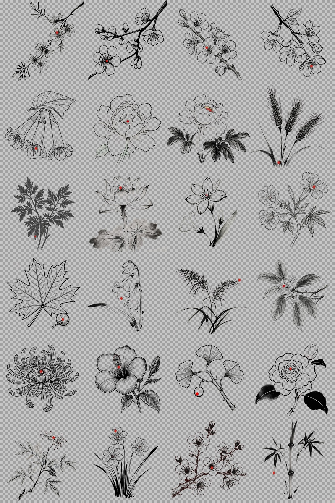

# 二十四节气 · 朱砂水墨简笔画集

> **24 Solar Terms · Vermilion Ink Sketch Collection**
> 一节气 · 一植物 · 一枚墨线简笔画 · 一点朱砂



## 这是什么

以《月令七十二候》与**二十四番花信风**为纲，为每个节气选定一种代表植物：先由 AI 生成一张植物摄影图，再转绘为一幅**禅意水墨线描简笔画**——黑色毛笔轮廓线、枯笔飞白，全画仅**一处朱砂红点**，落在最恰当的位置（有花蕊者点在花蕊正中央）。

所有简笔画为 **512×512 全透明 PNG（真 alpha 通道）**，可直接作为卡片、海报、PPT、UI 元素叠加使用，无需抠图。

## 二十四节气选目

| # | 节气 | 植物 | 依据 | 朱砂落点 |
|---|---|---|---|---|
| 01 | 立春 | 迎春花 | 迎春报岁，百花之先 | 最大花心 |
| 02 | 雨水 | 杏花 | 花信风·雨水二候 | 花蕊中央 |
| 03 | 惊蛰 | 桃花 | 花信风·惊蛰一候 | 花蕊中央 |
| 04 | 春分 | 海棠 | 花信风·春分一候 | 下垂花心 |
| 05 | 清明 | 桐花 | 花信风·清明一候 | 花蕊中央 |
| 06 | 谷雨 | 牡丹 | 花信风·谷雨一候 | 花蕊中央 |
| 07 | 立夏 | 芍药 | 「谷雨看牡丹，立夏看芍药」 | 花蕊中央 |
| 08 | 小满 | 麦穗 | 小满者，麦粒将满 | 根部 |
| 09 | 芒种 | 艾草 | 芒种逢端午，悬艾于门 | 叶尖 |
| 10 | 夏至 | 荷花 | 「接天莲叶无穷碧」 | 莲蓬花蕊 |
| 11 | 小暑 | 茉莉 | 盛夏茉莉，香远益清 | 花喉中央 |
| 12 | 大暑 | 凌霄花 | 大暑浓烈，攀架凌霄 | 花喉正中 |
| 13 | 立秋 | 梧桐 | 「一叶落而知天下秋」 | 果球 |
| 14 | 处暑 | 玉簪 | 夏末阴处玉簪始放 | 花口正中 |
| 15 | 白露 | 芦苇 | 「蒹葭苍苍，白露为霜」 | 穗尖 |
| 16 | 秋分 | 桂花 | 农历八月，桂香正盛 | 花簇中心 |
| 17 | 寒露 | 菊花 | 农历九月菊月 | 花蕊正中 |
| 18 | 霜降 | 木芙蓉 | 拒霜花，霜降正开 | 花心·瓣汇聚处 |
| 19 | 立冬 | 银杏 | 立冬银杏满地金 | 白果 |
| 20 | 小雪 | 山茶 | 初冬山茶初绽，岁寒后凋 | 盛开花心 |
| 21 | 大雪 | 南天竹 | 雪压南天竹，红果映雪 | 果簇 |
| 22 | 冬至 | 水仙 | 冬至置水仙，年宵之花 | 副冠中央 |
| 23 | 小寒 | 梅花 | 花信风之首：小寒一候梅花 | 花蕊正中（墨梅点蕊） |
| 24 | 大寒 | 竹 | 岁寒三友，大寒不改其节 | 叶尖 |

## 设计规则（定稿原则）

1. **纯线描**：黑色毛笔轮廓线 + 枯笔飞白，无灰色晕染、无排线纹理、无纸纹
2. **全画唯一一点朱砂**：红色有且仅有一处，且**不脱离物体**——有花蕊的植物点在花蕊正中央，叶/果/穗类点在叶尖、果球、穗尖或根部
3. **背景全透明**：真 PNG alpha 通道，任何底色/材质上直接叠用
4. **二倍图交付**：1024 生成 → 等比缩至 512×512，线条边缘平滑

## 目录结构

```
solar-terms/
├── README.md
├── 二十四节气植物图集.md      # 植物摄影图文档（选目依据 + 全图）
├── 二十四节气简笔画集.md      # 简笔画交付文档（朱砂位置 + 透明预览）
├── plants/                    # 24 张植物摄影图（1024×1024，GLM-Image 生成）
├── sketches/                  # 简笔画
│   ├── NN-节气-植物.png        # ★ 交付件：512×512 全透明 PNG
│   ├── NN-节气-植物-raw.png    # 1024 二倍原图（可重新后期）
│   └── NN-节气-植物-preview.jpg# 灰棋盘透明预览（GitHub 上查看效果用）
├── prompts/                   # 全部 48 条生成提示词（可复现）
└── contact/
    └── ALL-24-overview.jpg    # 24 图总览
```

## 使用方式

- **卡片背景**：直接取 `sketches/NN-*.png`（注意避开 `-raw` 与 `-preview`），透明背景可直接叠加任意底图/底色
- **在 GitHub 查看透明效果**：透明 PNG 在纯白/纯黑页面上不易判断边缘，可对照同名 `-preview.jpg`（灰棋盘格）
- **改红点位置/大小**：红点是独立盖印的，可自行用图像工具擦除重绘

## 制作管线

1. **植物图**：智谱 **GLM-Image** API 文生图（1024×1024，`watermark:false`）
2. **简笔画**：GLM-Image 按"纯线描 + 纯白背景"提示词生成（提示词见 `prompts/`）
3. **透明化**：白底转 alpha（近白裁切阈值 200）
4. **单点朱砂**：逐图视觉定位花蕊/焦点坐标后本地盖印颗粒状朱砂点
5. **质检**：像素级红点检测 + 视觉复核（印章/红日/游离点等反模式全部清除）

> ⚠️ **声明**：本图集所有图片均由 AI（GLM-Image）生成，非摄影实拍、非人工手绘。植物形态以文化意象为主，未做严格植物学考证。

## 致谢

- **[vermilion-sketch](https://github.com/Win-Hao/vermilion-sketch)**（by [Win-Hao](https://github.com/Win-Hao)）—— 本图集的画风与创作方法论源自该技能：禅意水墨简笔画（黑色毛笔轮廓线 + 枯笔飞白 + 唯一一点朱砂）、"减法为主、红点唯一"的定稿原则、逐图质检的生成流程。本项目在其基础上适配了 GLM-Image 文生图接口与全透明背景输出。

## License

[](https://creativecommons.org/publicdomain/zero/1.0/)

**CC0 1.0 公共领域贡献**：本图集全部内容已进入公共领域——可复制、修改、分发、商用，**无需署名、无需授权**。详见 [LICENSE](LICENSE)。
