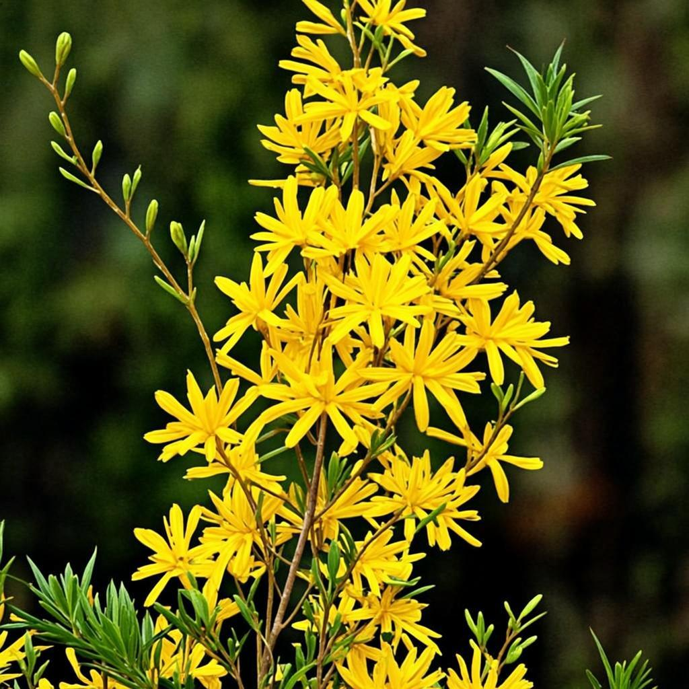
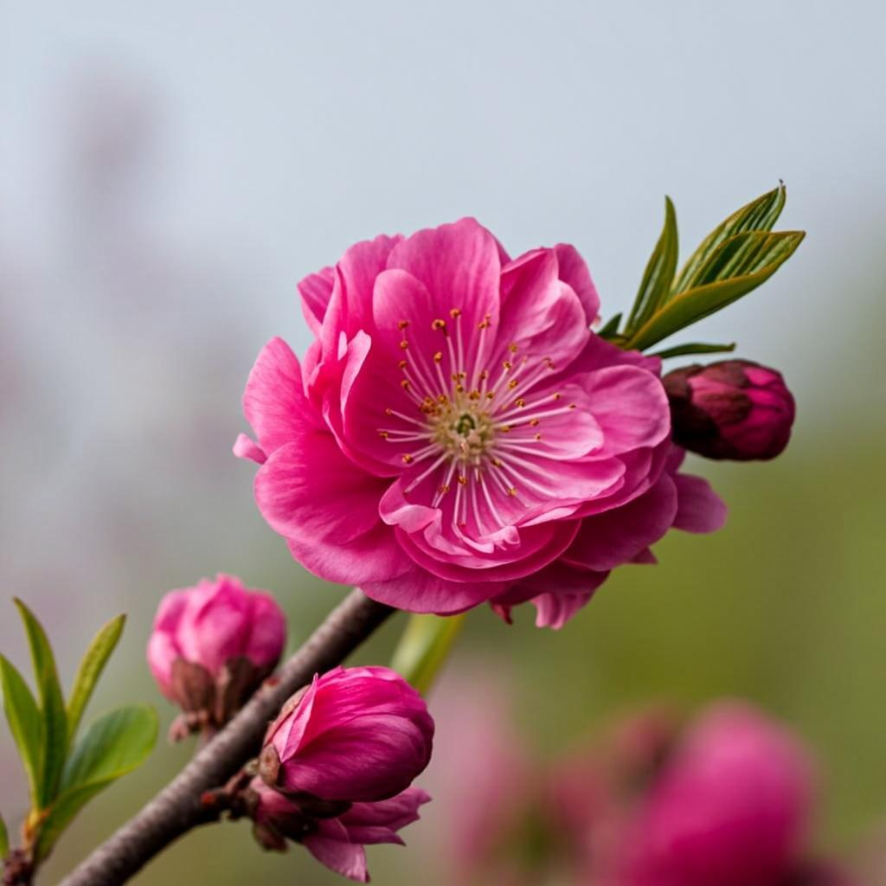
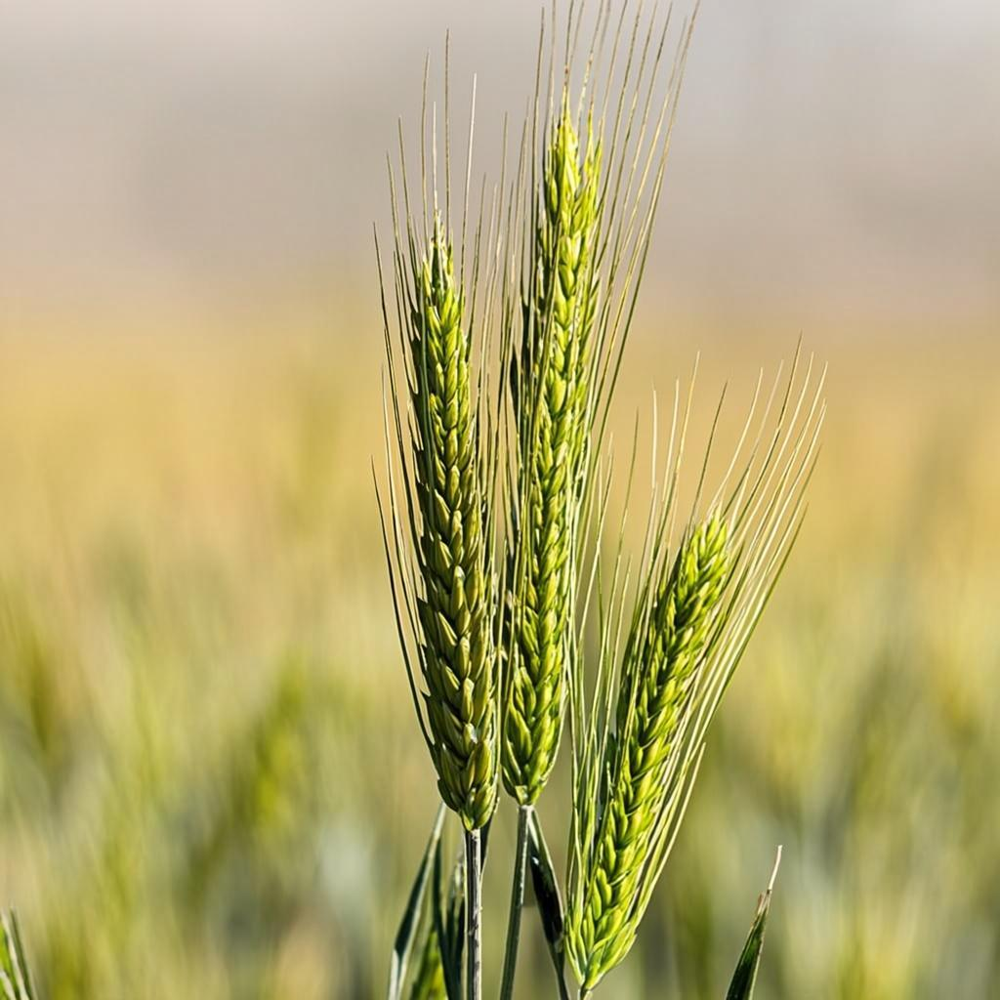
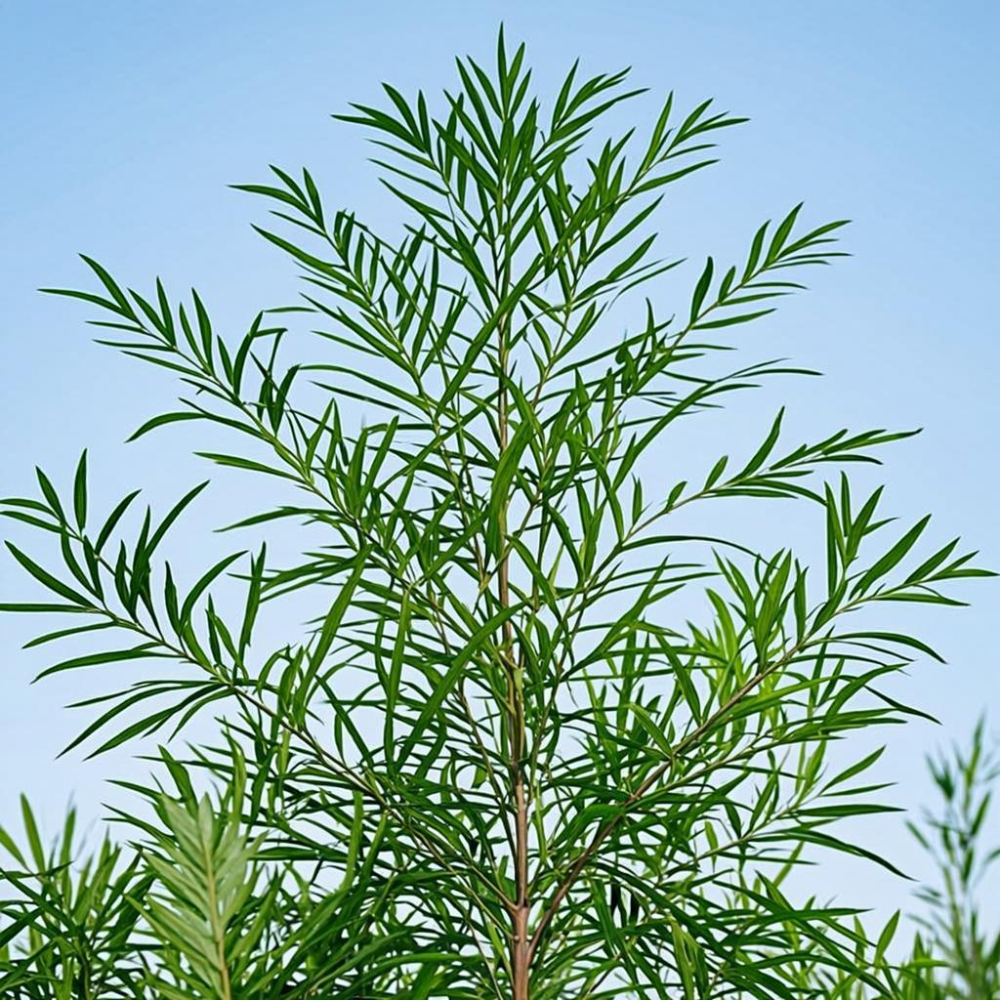
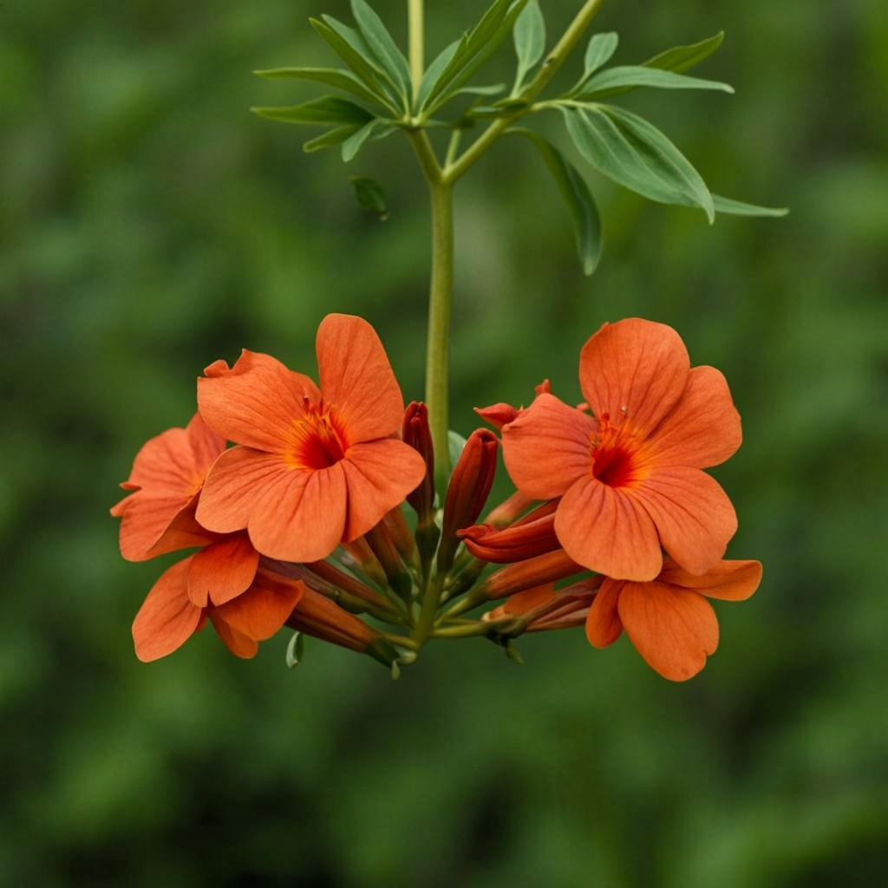
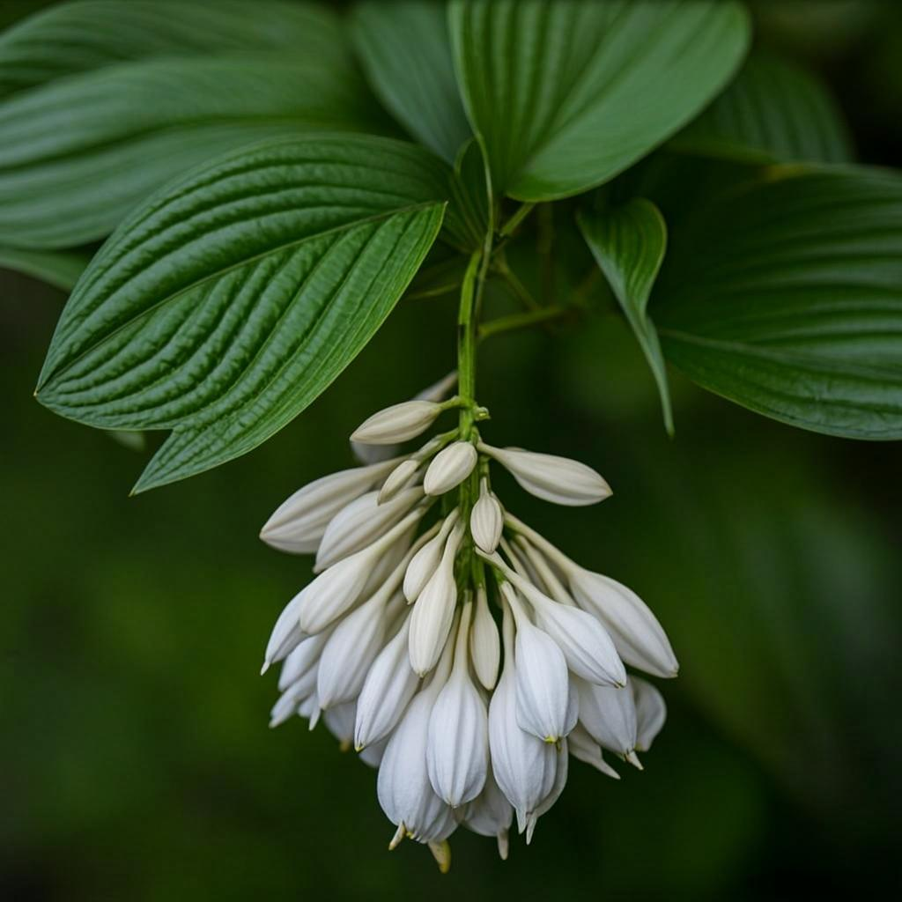
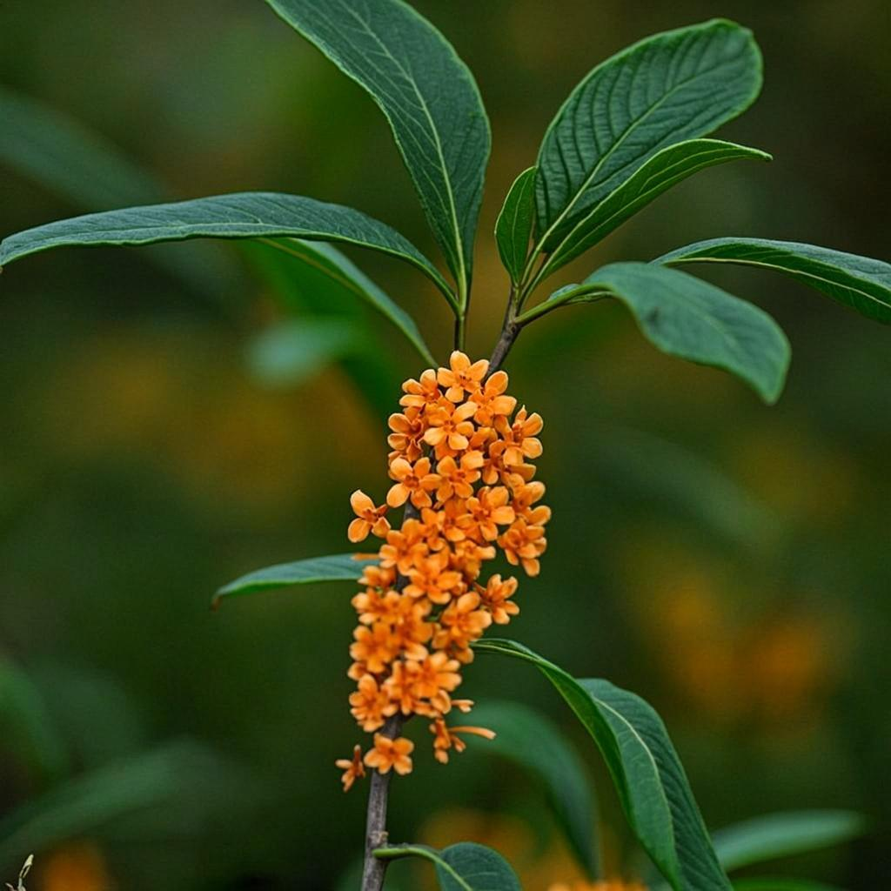
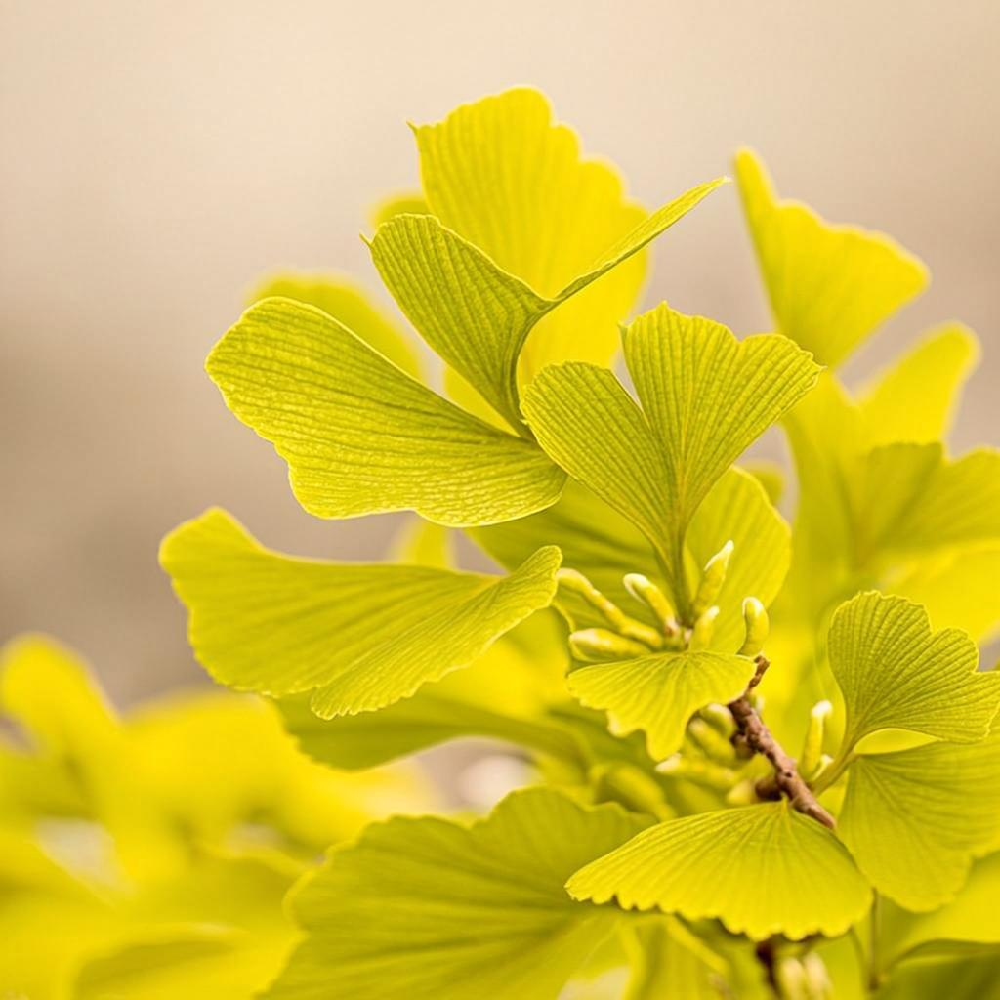
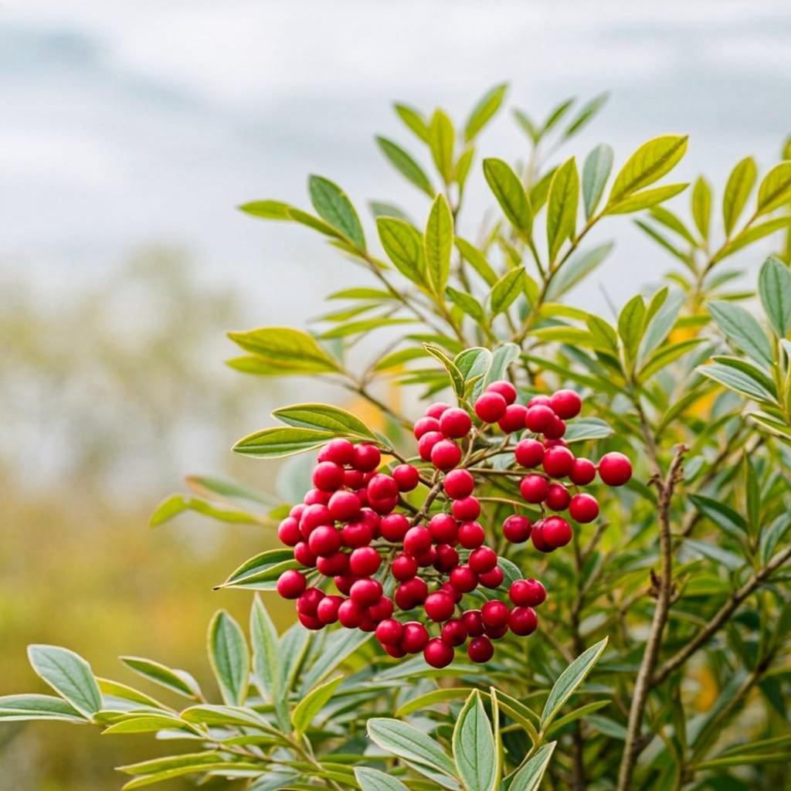

# 二十四节气植物图集

> 每节气一种代表植物（GLM-Image 生成，1024×1024）。
> 选材依据：《月令七十二候》、二十四番花信风、民谚诗典。
> 生成逐张进行，本表随进度更新。

| # | 节气 | 植物 | 依据 | 图片 |
|---|---|---|---|---|
| 01 | 立春 | 迎春花 | 迎春报岁，百花之先 | ✅  |
| 02 | 雨水 | 杏花 | 花信风·雨水二候 | ✅  |
| 03 | 惊蛰 | 桃花 | 花信风·惊蛰一候 | ✅  |
| 04 | 春分 | 海棠 | 花信风·春分一候 | ✅  |
| 05 | 清明 | 桐花 | 花信风·清明一候 | ✅  |
| 06 | 谷雨 | 牡丹 | 花信风·谷雨一候 | ✅  |
| 07 | 立夏 | 芍药 | 民谚「谷雨看牡丹，立夏看芍药」 | ✅  |
| 08 | 小满 | 麦穗 | 小满者，麦粒将满 | ✅  |
| 09 | 芒种 | 艾草 | 芒种逢端午，悬艾于门 | ✅  |
| 10 | 夏至 | 荷花 | 「接天莲叶无穷碧」 | ✅  |
| 11 | 小暑 | 茉莉 | 盛夏茉莉，香远益清 | ✅  |
| 12 | 大暑 | 凌霄花 | 大暑浓烈，攀架凌霄 | ✅  |
| 13 | 立秋 | 梧桐 | 「一叶落而知天下秋」 | ✅  |
| 14 | 处暑 | 玉簪 | 夏末阴处玉簪始放 | ✅  |
| 15 | 白露 | 芦苇 | 「蒹葭苍苍，白露为霜」 | ✅  |
| 16 | 秋分 | 桂花 | 农历八月，桂香正盛 | ✅  |
| 17 | 寒露 | 菊花 | 农历九月菊月 | ✅  |
| 18 | 霜降 | 木芙蓉 | 拒霜花，霜降正开 | ✅  |
| 19 | 立冬 | 银杏 | 立冬银杏满地金 | ✅  |
| 20 | 小雪 | 山茶 | 初冬山茶初绽，岁寒后凋 | ✅  |
| 21 | 大雪 | 南天竹 | 雪压南天竹，红果映雪 | ✅  |
| 22 | 冬至 | 水仙 | 冬至置水仙，年宵之花 | ✅  |
| 23 | 小寒 | 梅花 | 花信风之首：小寒一候梅花 | ✅  |
| 24 | 大寒 | 竹 | 岁寒三友，大寒不改其节 | ✅  |

---

## 图集明细

### 01 立春 · 迎春花

- 六瓣星形黄花、拱垂绿枝、带蕾；浅景深虚化背景，1024×1024
- 生成提示词：`prompts/01-立春-迎春花-plant.txt`

### 02 雨水 · 杏花

- 1024×1024；生成提示词：`prompts/02-雨水-杏花-plant.txt`

### 03 惊蛰 · 桃花

- 1024×1024；生成提示词：`prompts/03-惊蛰-桃花-plant.txt`

### 04 春分 · 海棠

- 1024×1024；生成提示词：`prompts/04-春分-海棠-plant.txt`

### 05 清明 · 桐花

- 1024×1024；生成提示词：`prompts/05-清明-桐花-plant.txt`

### 06 谷雨 · 牡丹

- 1024×1024；生成提示词：`prompts/06-谷雨-牡丹-plant.txt`

### 07 立夏 · 芍药

- 1024×1024；生成提示词：`prompts/07-立夏-芍药-plant.txt`

### 08 小满 · 麦穗

- 1024×1024；生成提示词：`prompts/08-小满-麦穗-plant.txt`

### 09 芒种 · 艾草

- 1024×1024；生成提示词：`prompts/09-芒种-艾草-plant.txt`

### 10 夏至 · 荷花

- 1024×1024；生成提示词：`prompts/10-夏至-荷花-plant.txt`

### 11 小暑 · 茉莉

- 1024×1024；生成提示词：`prompts/11-小暑-茉莉-plant.txt`

### 12 大暑 · 凌霄花

- 1024×1024；生成提示词：`prompts/12-大暑-凌霄花-plant.txt`

### 13 立秋 · 梧桐

- 1024×1024；生成提示词：`prompts/13-立秋-梧桐-plant.txt`

### 14 处暑 · 玉簪

- 1024×1024；生成提示词：`prompts/14-处暑-玉簪-plant.txt`

### 15 白露 · 芦苇

- 1024×1024；生成提示词：`prompts/15-白露-芦苇-plant.txt`

### 16 秋分 · 桂花

- 1024×1024；生成提示词：`prompts/16-秋分-桂花-plant.txt`

### 17 寒露 · 菊花

- 1024×1024；生成提示词：`prompts/17-寒露-菊花-plant.txt`

### 18 霜降 · 木芙蓉

- 1024×1024；生成提示词：`prompts/18-霜降-木芙蓉-plant.txt`

### 19 立冬 · 银杏

- 1024×1024；生成提示词：`prompts/19-立冬-银杏-plant.txt`

### 20 小雪 · 山茶

- 1024×1024；生成提示词：`prompts/20-小雪-山茶-plant.txt`

### 21 大雪 · 南天竹

- 1024×1024；生成提示词：`prompts/21-大雪-南天竹-plant.txt`

### 22 冬至 · 水仙

- 1024×1024；生成提示词：`prompts/22-冬至-水仙-plant.txt`

### 23 小寒 · 梅花

- 1024×1024；生成提示词：`prompts/23-小寒-梅花-plant.txt`

### 24 大寒 · 竹

- 1024×1024；生成提示词：`prompts/24-大寒-竹-plant.txt`

（逐张追加）
