# 二十四节气简笔画集（vermilion-sketch · 全透明背景）

> 由植物图集逐张转为禅意水墨简笔画：黑色毛笔轮廓线 + 1–2 点朱砂，
> **背景全透明（PNG alpha 通道）**，可直接作卡片背景叠用。
> 规格：1024 二倍图生成 → 等比缩至 **512×512** 交付。
> **定稿原则（2026-11-06）：每图仅一处最恰当的朱砂，红点不脱离物体；艾草绿叶已转墨色。**
> 生成逐张进行，本表随进度更新。

| # | 节气 | 植物 | 朱砂落点 | 透明PNG |
|---|---|---|---|---|
| 01 | 立春 | 迎春花 | 最大花心（1 点） | ✅ 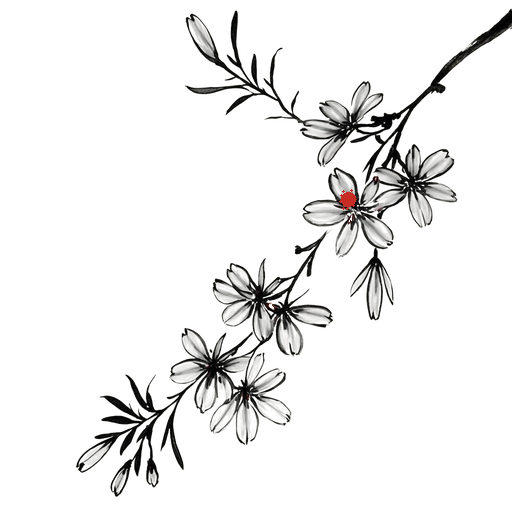 |
| 02 | 雨水 | 杏花 | 最大花心（1 点） | ✅ 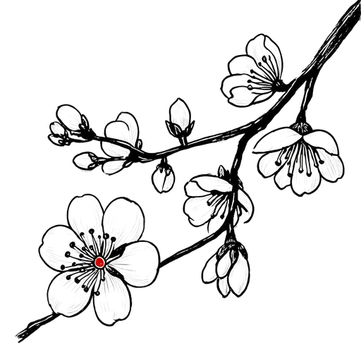 |
| 03 | 惊蛰 | 桃花 | 花心（1 点） | ✅ 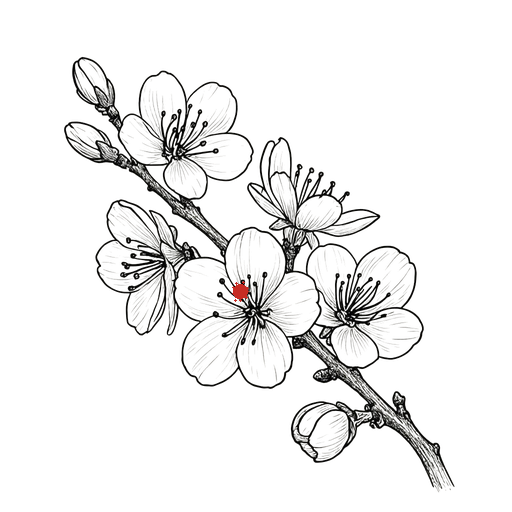 |
| 04 | 春分 | 海棠 | 下垂花心（1 点） | ✅ 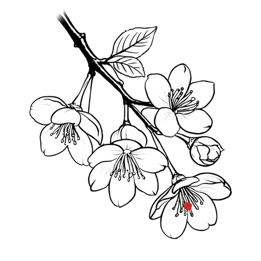 |
| 05 | 清明 | 桐花 | 花蕊（1 点） | ✅ 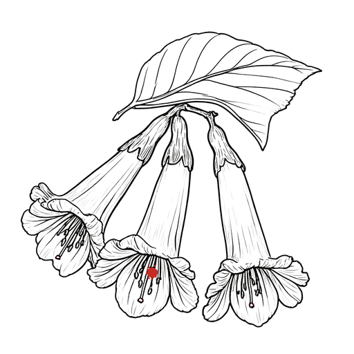 |
| 06 | 谷雨 | 牡丹 | 花心（1 点） | ✅ 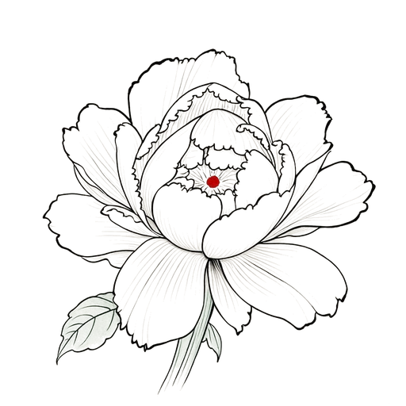 |
| 07 | 立夏 | 芍药 | 花心（1 点） | ✅ 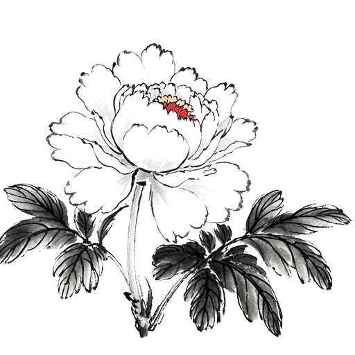 |
| 08 | 小满 | 麦穗 | 根部（1 点） | ✅ 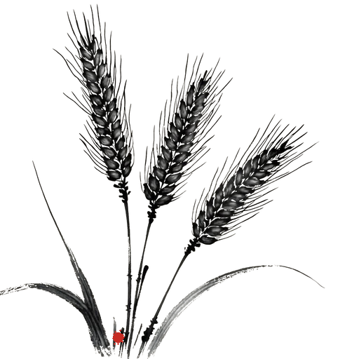 |
| 09 | 芒种 | 艾草 | 叶尖（1 点·绿叶已转墨） | ✅ 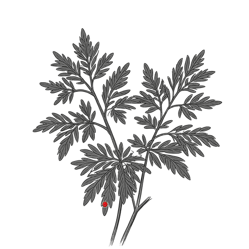 |
| 10 | 夏至 | 荷花 | 花蕊（1 点） | ✅ 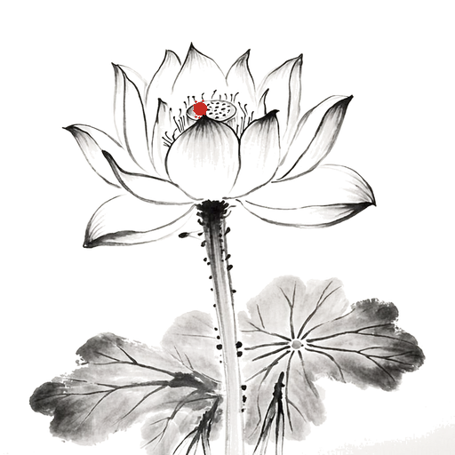 |
| 11 | 小暑 | 茉莉 | 花喉（1 点） | ✅ 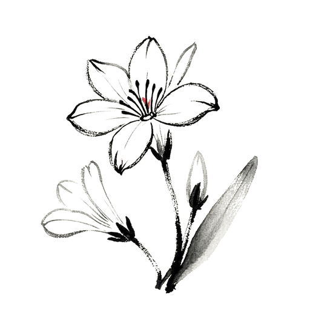 |
| 12 | 大暑 | 凌霄花 | 最大花喉（1 点·已删私印） | ✅ 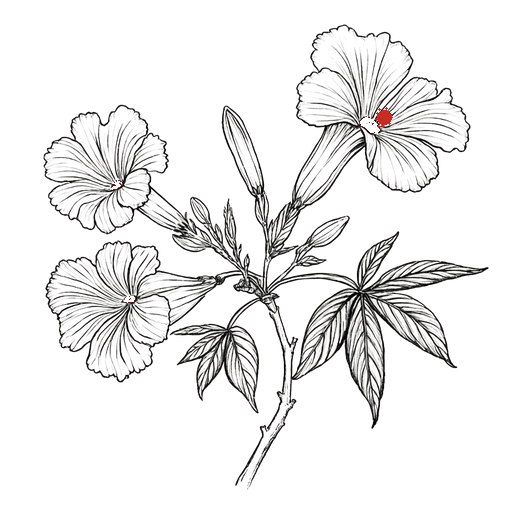 |
| 13 | 立秋 | 梧桐 | 果球（1 点·已删红日） | ✅  |
| 14 | 处暑 | 玉簪 | 花口中央（1 点） | ✅ 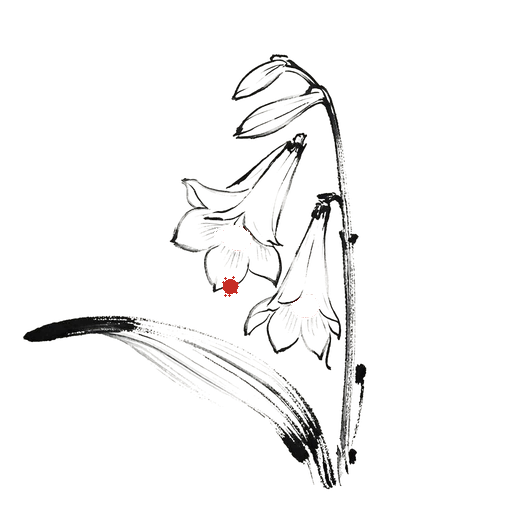 |
| 15 | 白露 | 芦苇 | 穗尖（1 点） | ✅ 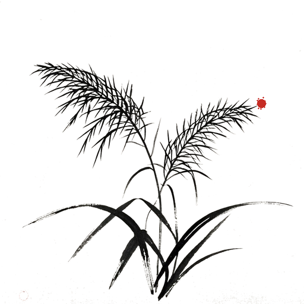 |
| 16 | 秋分 | 桂花 | 花簇中心（1 点） | ✅ 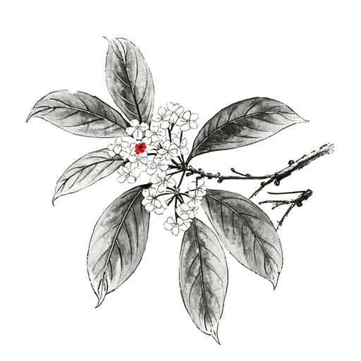 |
| 17 | 寒露 | 菊花 | 花心（1 点） | ✅ 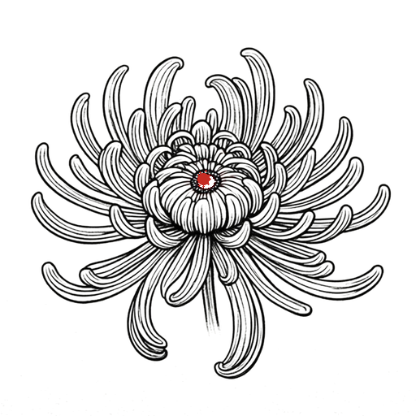 |
| 18 | 霜降 | 木芙蓉 | 花心·瓣汇聚处（1 点） | ✅ 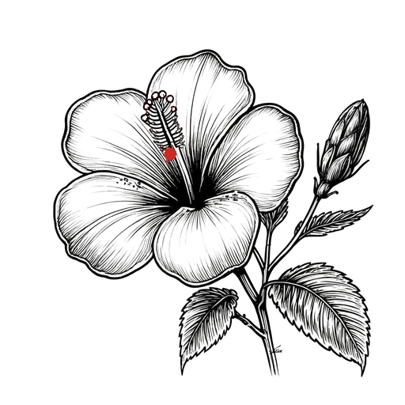 |
| 19 | 立冬 | 银杏 | 白果（1 点） | ✅ 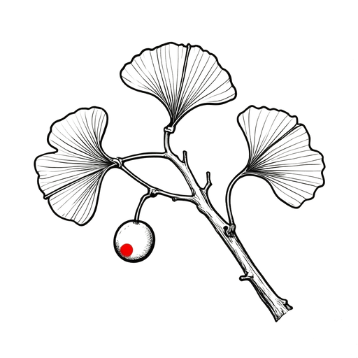 |
| 20 | 小雪 | 山茶 | 盛开花心（1 点） | ✅ 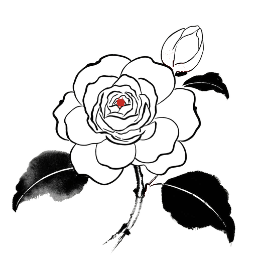 |
| 21 | 大雪 | 南天竹 | 主簇浆果（1 处） | ✅ 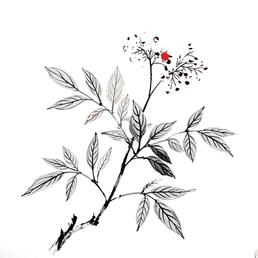 |
| 22 | 冬至 | 水仙 | 副冠（1 点） | ✅ 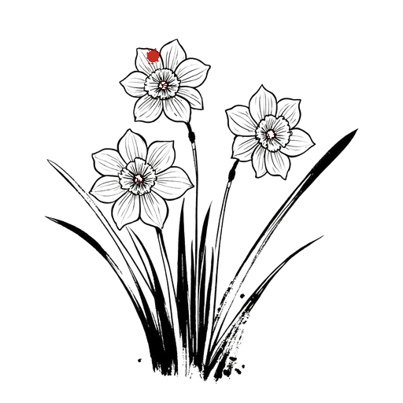 |
| 23 | 小寒 | 梅花 | 花心（1 点·红蕊红蕾已转墨） | ✅ 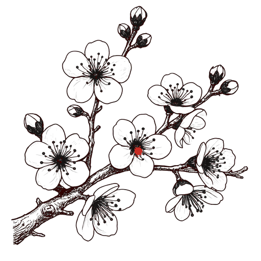 |
| 24 | 大寒 | 竹 | 竹叶尖（1 点） | ✅ 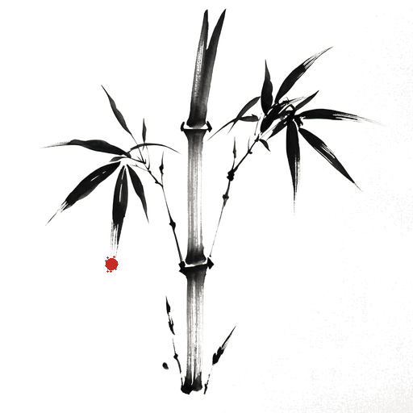 |

---

## 图集明细

### 01 立春 · 迎春花（全透明 PNG）

- 黑色毛笔轮廓线 + 枯笔飞白，约 8 朵六瓣星形花 + 花蕾，1 条自右上斜入的拱垂枝
- 朱砂 2 点：两朵花的花心
- 背景全透明（白转 alpha，近白裁切）；透明效果预览：`sketches/01-立春-迎春花-preview.jpg`（灰棋盘格）
- 生成提示词：`prompts/01-立春-迎春花-sketch.txt`

### 02 雨水 · 杏花（全透明 PNG）

- 一枝斜出的杏花，枝上绽放六朵五瓣圆瓣小花、三枚花蕾；朱砂：最大花心 + 蕾尖（2 点）
- 透明预览：`sketches/02-雨水-杏花-preview.jpg`；提示词：`prompts/02-雨水-杏花-sketch.txt`

### 03 惊蛰 · 桃花（全透明 PNG）

- 一枝桃花，六朵五瓣花、四枚尖蕾、两片嫩叶；朱砂：花心 + 蕾尖（2 点）
- 透明预览：`sketches/03-惊蛰-桃花-preview.jpg`；提示词：`prompts/03-惊蛰-桃花-sketch.txt`

### 04 春分 · 海棠（全透明 PNG）

- 一枝垂丝海棠，五朵粉红花下垂于细长花梗上，配三枚花蕾和两片叶；朱砂：下垂花心 + 蕾尖（2 点）
- 透明预览：`sketches/04-春分-海棠-preview.jpg`；提示词：`prompts/04-春分-海棠-sketch.txt`

### 05 清明 · 桐花（全透明 PNG）

- 一串桐花，三朵筒状铃铛形花侧垂，配两枚圆蕾和一片阔叶；朱砂：筒口 + 蓓蕾（2 点）
- 透明预览：`sketches/05-清明-桐花-preview.jpg`；提示词：`prompts/05-清明-桐花-sketch.txt`

### 06 谷雨 · 牡丹（全透明 PNG）

- 一朵盛放的牡丹，约二十片层叠皱瓣，中心花瓣内聚，配一片侧叶；朱砂：花心 + 内层瓣尖（2 点）
- 透明预览：`sketches/06-谷雨-牡丹-preview.jpg`；提示词：`prompts/06-谷雨-牡丹-sketch.txt`

### 07 立夏 · 芍药（全透明 PNG）

- 一朵侧放的芍药，约十六片舒展花瓣略呈杯状，配一枚圆蕾；朱砂：花心 + 蕾尖（2 点）
- 透明预览：`sketches/07-立夏-芍药-preview.jpg`；提示词：`prompts/07-立夏-芍药-sketch.txt`

### 08 小满 · 麦穗（全透明 PNG）

- 三支麦穗斜立，穗粒左右对列，长芒用细劲线条；朱砂：颖果 + 穗颈（2 点）
- 透明预览：`sketches/08-小满-麦穗-preview.jpg`；提示词：`prompts/08-小满-麦穗-sketch.txt`

### 09 芒种 · 艾草（全透明 PNG）

- 三枝艾草，羽状裂叶用简劲轮廓，茎直挺；朱砂：叶尖 + 缺刻（2 点）
- 透明预览：`sketches/09-芒种-艾草-preview.jpg`；提示词：`prompts/09-芒种-艾草-sketch.txt`

### 10 夏至 · 荷花（全透明 PNG）

- 一朵盛放的荷花约十六瓣舒展，一条挺直花梗带小刺，下方一片荷叶只画侧缘三笔；朱砂：莲蓬 + 内层瓣尖（2 点）
- 透明预览：`sketches/10-夏至-荷花-preview.jpg`；提示词：`prompts/10-夏至-荷花-sketch.txt`

### 11 小暑 · 茉莉（全透明 PNG）

- 一枝茉莉，六朵小型高脚碟状花与四枚细长蕾；朱砂：花喉 + 蕾尖（2 点）
- 透明预览：`sketches/11-小暑-茉莉-preview.jpg`；提示词：`prompts/11-小暑-茉莉-sketch.txt`

### 12 大暑 · 凌霄花（全透明 PNG）

- 一藤凌霄，三朵漏斗形花侧放、花冠五浅裂外翻，配两枚蕾与羽状复叶；朱砂：花喉 + 蕾尖（2 点）
- 透明预览：`sketches/12-大暑-凌霄花-preview.jpg`；提示词：`prompts/12-大暑-凌霄花-sketch.txt`

### 13 立秋 · 梧桐（全透明 PNG）

- 一片掌状大梧桐叶与一枚球形果，主脉与五条侧脉简劲；朱砂：叶尖 + 果球（2 点）
- 透明预览：`sketches/13-立秋-梧桐-preview.jpg`；提示词：`prompts/13-立秋-梧桐-sketch.txt`

### 14 处暑 · 玉簪（全透明 PNG）

- 一枝玉簪花穗，四朵管状白花侧开，配一片宽弯叶；朱砂：花喉 + 叶弯（2 点）
- 透明预览：`sketches/14-处暑-玉簪-preview.jpg`；提示词：`prompts/14-处暑-玉簪-sketch.txt`

### 15 白露 · 芦苇（全透明 PNG）

- 三枝芦苇，穗用松散细线成絮，叶细长披垂；朱砂：两枝穗尖（2 点）
- 透明预览：`sketches/15-白露-芦苇-preview.jpg`；提示词：`prompts/15-白露-芦苇-sketch.txt`

### 16 秋分 · 桂花（全透明 PNG）

- 一枝桂，四片革质叶与两簇细点状小花；朱砂：两簇花心（2 点）
- 透明预览：`sketches/16-秋分-桂花-preview.jpg`；提示词：`prompts/16-秋分-桂花-sketch.txt`

### 17 寒露 · 菊花（全透明 PNG）

- 一朵菊，细长瓣约二十条向外舒展微卷，中心瓣内聚；朱砂：花心 + 一瓣尖（2 点）
- 透明预览：`sketches/17-寒露-菊花-preview.jpg`；提示词：`prompts/17-寒露-菊花-sketch.txt`

### 18 霜降 · 木芙蓉（全透明 PNG）

- 一朵大芙蓉五瓣舒展，配一枚尖蕾与一片阔叶；朱砂：花心 + 蕾尖（2 点）
- 透明预览：`sketches/18-霜降-木芙蓉-preview.jpg`；提示词：`prompts/18-霜降-木芙蓉-sketch.txt`

### 19 立冬 · 银杏（全透明 PNG）

- 一枝银杏，三片扇形叶带二裂叶缘，一粒白果；朱砂：白果 + 叶裂口（2 点）
- 透明预览：`sketches/19-立冬-银杏-preview.jpg`；提示词：`prompts/19-立冬-银杏-sketch.txt`

### 20 小雪 · 山茶（全透明 PNG）

- 一朵重瓣山茶与一枚大蕾、两片叶；朱砂：蕾尖 + 叶芽（2 点）
- 透明预览：`sketches/20-小雪-山茶-preview.jpg`；提示词：`prompts/20-小雪-山茶-sketch.txt`

### 21 大雪 · 南天竹（全透明 PNG）

- 一枝南天竹，羽状复叶三五片，枝端两簇浆果成球；朱砂：两簇红浆果天然成簇（约 20 粒）
- 透明预览：`sketches/21-大雪-南天竹-preview.jpg`；提示词：`prompts/21-大雪-南天竹-sketch.txt`

### 22 冬至 · 水仙（全透明 PNG）

- 一束水仙，三朵六瓣花配杯状副冠，带状叶两三片；朱砂：副冠 + 叶尖（2 点）
- 透明预览：`sketches/22-冬至-水仙-preview.jpg`；提示词：`prompts/22-冬至-水仙-sketch.txt`

### 23 小寒 · 梅花（全透明 PNG）

- 一枝虬曲梅，五朵五瓣花与四枚圆蕾，枝干转折有骨力；朱砂：花心 + 蕾尖（2 点）
- 透明预览：`sketches/23-小寒-梅花-preview.jpg`；提示词：`prompts/23-小寒-梅花-sketch.txt`

### 24 大寒 · 竹（全透明 PNG）

- 一竿竹三段竹节，分枝垂竹叶三五片呈个字形，叶用撇笔；朱砂：两片叶尖（2 点）
- 透明预览：`sketches/24-大寒-竹-preview.jpg`；提示词：`prompts/24-大寒-竹-sketch.txt`

（逐张追加）

---

> 🎉 **24 张全部完成。** 总览图：`contact/ALL-24-overview.jpg`；原始 1024 二倍图存于 `sketches/*-raw.png` 可随时重制。
